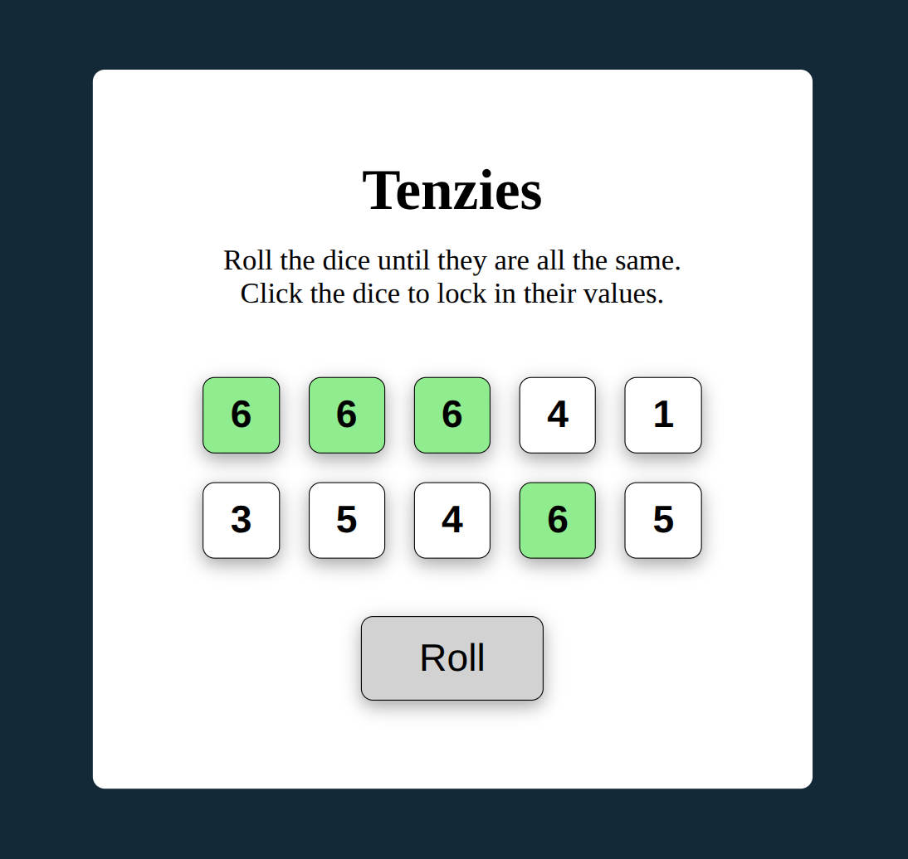

# Tenzies

This is a basic dice rolling game.
The goal of the game is to get all the dice to be the same number.
Roll the dice with the roll button, and click the dice to lock in their values.

# Running the project

- After cloning the project, run npm install
- Run the command npm run dev to start a local development server
- Alternatively, you can use npm run build and npm run preview
